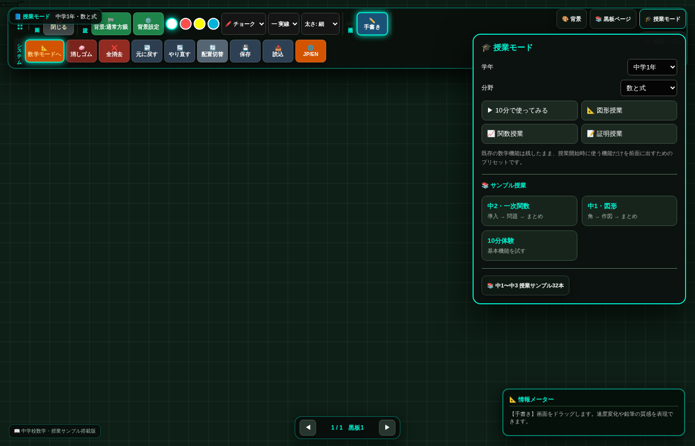

# 最高峰デジタル学習黒板 - Interactive Educational Blackboard

学校の授業・塾・家庭学習で使える、Webブラウザだけで動く電子黒板アプリです。
インストール不要、`index.html` を開くだけですぐに使えます。
GIGAスクール構想の端末（Chromebook／iPad／Windowsタブレット等）や電子黒板での利用を想定しています。

## 主な機能

- **標準モード**：チョーク、鉛筆、毛筆、蛍光ペン、ネオンペンでの自由描画
- **数学モード**：点・線・円の作図、図形自動生成（三角形・正方形など）、動的な図形変形、長さ・角度の測定
- **関数グラフ**：分数入力対応キーパッドで数式を入れると、グラフを即座に描画
- **5種類の背景**：通常方眼、英語4線、十字マス、座標平面など切り替え可能
- **授業支援機能**：複数ページ管理、画面を隠すカーテン（目隠し）機能、自動保存、日本語/英語切り替え、授業サンプル32本

## 使い方

1. このリポジトリをダウンロード（またはクローン）します。
2. `index.html` をダブルクリックし、Webブラウザ（Chrome、Edge、Safari等）で開きます。
3. 画面上のツールバーでペンや色を選び、画面をなぞって描画します。
4. 「数学モードへ」ボタンを押すと、図形作図や測定ツールが使えます。
5. 右上のドックから「背景」「黒板ページ」「授業モード」「授業ツール」の各パネルを開閉できます（✕ボタン／パネル外タップ／同じボタンの再クリックのいずれでも閉じられます）。

詳しい操作方法は [`Digital_Blackboard_Manual.pdf`](./Digital_Blackboard_Manual.pdf) を参照してください。

## GitHub Pagesで公開する場合

1. このリポジトリの **Settings → Pages** を開く
2. Source を `Deploy from a branch`、Branch を `main` / `(root)` に設定して保存
3. 数分後、`https://<ユーザー名>.github.io/<リポジトリ名>/` でアクセス可能になります
   （`index.html` がルート直下にあるため追加設定は不要です）

## 動作環境

Windows 10/11、macOS、iPadOS、iOS、Android の最新Webブラウザ（インターネット接続不要・完全ローカル動作）

## 変更履歴

詳細は [CHANGELOG.md](./CHANGELOG.md) を参照してください。
直近の更新で、背景設定パネルが閉じられなくなる不具合、および背景設定の一部が画面に反映されない不具合を修正しています。

## ライセンス

MITライセンス（フリーソフト）。営利・非営利を問わず自由に再配布・改変・利用いただけます。
詳細は [LICENSE](./LICENSE) を参照してください。

## 著作権者・連絡先

清水　正典　( masanori432@icloud.com )
